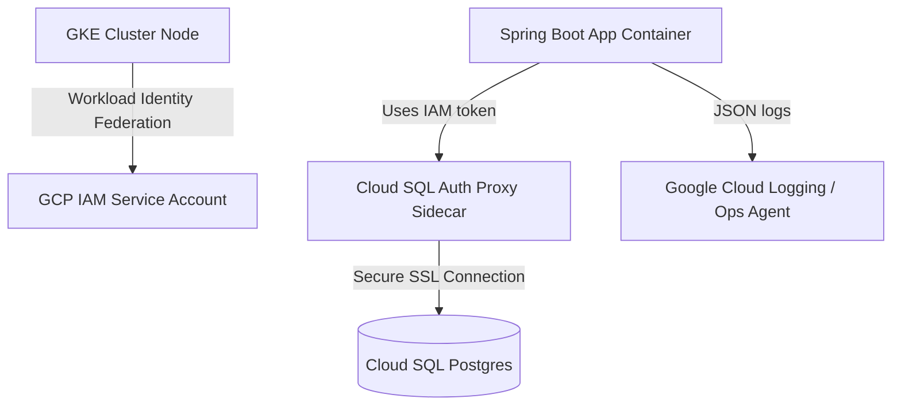

# Deployment & Cloud Operations Guide (Parts 2 & 3)

This guide provides a comprehensive roadmap, configuration drafts, and implementation details for:
- **Part 2**: Local Kubernetes (Orbstack) deployment using Terraform, including logging ingestion via Kibana.
- **Part 3**: GCP Cloud deployment with GCP IAM-provided database authentication.

---

# Part 2: Local Kubernetes Deployment (Orbstack) & Kibana Logging

This section covers containerizing the Spring Boot service, defining Terraform deployments to target your local Orbstack Kubernetes cluster, and configuring log forwarding to Kibana.

## 1. Containerizing the Service (`Dockerfile`)
To run the service in Kubernetes, create a multi-stage `Dockerfile` in the project root:

```dockerfile
# Stage 1: Build the application
FROM maven:3.9.6-eclipse-temurin-21-alpine AS builder
WORKDIR /app
COPY pom.xml .
RUN mvn dependency:go-offline
COPY src ./src
RUN mvn clean package -DskipTests

# Stage 2: Runtime image
FROM eclipse-temurin:21-jre-alpine
WORKDIR /app
RUN addgroup -S appgroup && adduser -S appuser -G appgroup
USER appuser
COPY --from=builder /app/target/reactive-guide-0.0.1-SNAPSHOT.jar app.jar
EXPOSE 8080
ENTRYPOINT ["java", "-jar", "app.jar"]
```

Build and tag the image locally:
```bash
docker build -t reactive-guide:latest .
```

---

## 2. Terraform Infrastructure Configuration
Terraform will manage the local deployment of Postgres, the Spring Boot app, services, and configuration in the local Orbstack cluster.

### `main.tf`
Create a directory named `terraform/` and define the deployment:

```hcl
terraform {
  required_version = ">= 1.5.0"
  required_providers {
    kubernetes = {
      source  = "hashicorp/kubernetes"
      version = "~> 2.23.0"
    }
  }
}

provider "kubernetes" {
  # Orbstack automatically configures a context named "orbstack"
  config_path    = "~/.kube/config"
  config_context = "orbstack"
}

# --- POSTGRES DATABASE DEPLOYMENT ---

resource "kubernetes_service" "postgres" {
  metadata {
    name = "postgres"
  }
  spec {
    selector = {
      app = "postgres"
    }
    port {
      port        = 5432
      target_port = 5432
    }
  }
}

resource "kubernetes_deployment" "postgres" {
  metadata {
    name = "postgres"
    labels = {
      app = "postgres"
    }
  }
  spec {
    replicas = 1
    selector {
      match_labels = {
        app = "postgres"
      }
    }
    template {
      metadata {
        labels = {
          app = "postgres"
        }
      }
      spec {
        container {
          name  = "postgres"
          image = "postgres:15-alpine"
          env {
            name  = "POSTGRES_DB"
            value = "paymentdb"
          }
          env {
            name  = "POSTGRES_USER"
            value = "postgres"
          }
          env {
            name  = "POSTGRES_PASSWORD"
            value = "password"
          }
          port {
            container_port = 5432
          }
        }
      }
    }
  }
}

# --- SPRING BOOT APP DEPLOYMENT ---

resource "kubernetes_config_map" "app_config" {
  metadata {
    name = "reactive-guide-config"
  }
  data = {
    "SPRING_R2DBC_URL"      = "r2dbc:postgresql://postgres:5432/paymentdb"
    "SPRING_R2DBC_USERNAME" = "postgres"
    "SPRING_R2DBC_PASSWORD" = "password"
  }
}

resource "kubernetes_deployment" "app" {
  metadata {
    name = "reactive-guide-app"
    labels = {
      app = "reactive-guide"
    }
  }
  spec {
    replicas = 2
    selector {
      match_labels = {
        app = "reactive-guide"
      }
    }
    template {
      metadata {
        labels = {
          app = "reactive-guide"
        }
      }
      spec {
        container {
          name  = "app"
          image = "reactive-guide:latest"
          image_pull_policy = "Never" # Uses the image built locally in Orbstack's Docker daemon
          port {
            container_port = 8080
          }
          env_from {
            config_map_ref {
              name = kubernetes_config_map.app_config.metadata[0].name
            }
          }
          liveness_probe {
            http_get {
              path = "/health"
              port = 8080
            }
            initial_delay_seconds = 15
            period_seconds        = 10
          }
          readiness_probe {
            http_get {
              path = "/health"
              port = 8080
            }
            initial_delay_seconds = 10
            period_seconds        = 5
          }
        }
      }
    }
  }
}

resource "kubernetes_service" "app" {
  metadata {
    name = "reactive-guide-service"
  }
  spec {
    selector = {
      app = "reactive-guide"
    }
    port {
      port        = 80
      target_port = 8080
    }
    type = "ClusterIP"
  }
}
```

---

## 3. Log Capture via Kibana
To capture logs from the service and view them in Kibana on your local Orbstack cluster, set up a lightweight **EFK (Elasticsearch, Fluent Bit, Kibana)** logging stack.

### Workflow:
1. **Non-blocking JSON Log Output**: Configure Spring Boot to output logs asynchronously (using the non-blocking `logback-spring.xml` with `<neverBlock>true</neverBlock>`) to prevent I/O blocking from affecting high-throughput reactive threads, formatted as structured JSON for pre-parsing.
2. **Log Collector (Fluent Bit)**: Deploy Fluent Bit as a DaemonSet to tail standard output container log files at `/var/log/containers/*` in Kubernetes.
3. **Storage (Elasticsearch)**: Fluent Bit ships these logs directly to an Elasticsearch deployment running in the cluster.
4. **Visualization (Kibana)**: Kibana connects to Elasticsearch, allowing you to search, filter, and visualize events.


### Local EFK Manifest File (`logging-stack.yaml`):
Deploy Elasticsearch and Kibana locally using `kubectl apply -f logging-stack.yaml`:

```yaml
apiVersion: apps/v1
kind: Deployment
metadata:
  name: elasticsearch
  namespace: kube-system
spec:
  selector:
    matchLabels:
      app: elasticsearch
  template:
    metadata:
      labels:
        app: elasticsearch
    spec:
      containers:
      - name: elasticsearch
        image: docker.elastic.co/elasticsearch/elasticsearch:8.11.1
        env:
        - name: discovery.type
          value: single-node
        - name: xpack.security.enabled
          value: "false"
        ports:
        - containerPort: 9200
---
apiVersion: v1
kind: Service
metadata:
  name: elasticsearch
  namespace: kube-system
spec:
  selector:
    app: elasticsearch
  ports:
  - port: 9200
    targetPort: 9200
---
apiVersion: apps/v1
kind: Deployment
metadata:
  name: kibana
  namespace: kube-system
spec:
  selector:
    matchLabels:
      app: kibana
  template:
    metadata:
      labels:
        app: kibana
    spec:
      containers:
      - name: kibana
        image: docker.elastic.co/kibana/kibana:8.11.1
        env:
        - name: ELASTICSEARCH_HOSTS
          value: "http://elasticsearch:9200"
        ports:
        - containerPort: 5601
---
apiVersion: v1
kind: Service
metadata:
  name: kibana
  namespace: kube-system
spec:
  selector:
    app: kibana
  ports:
  - port: 5601
    targetPort: 5601
  type: LoadBalancer # Automatically exposed on http://localhost:5601 on Orbstack
```

*Note: For Fluent Bit, deploy the official Helm Chart `fluent/fluent-bit` configured to forward logs to `http://elasticsearch.kube-system.svc:9200`.*

---

# Part 3: Cloud Deployment (Google Cloud Platform - GCP)

For a production cloud environment, we will transition local infrastructure to Google Kubernetes Engine (GKE), Google Cloud SQL (PostgreSQL), and Cloud IAM authentication.



## 1. GKE & Cloud SQL Configuration with Workload Identity
Rather than using static database passwords, deploy the application utilizing **Workload Identity Federation** to securely connect to Cloud SQL using IAM credentials.

### Step 1: Create a Google Service Account (GSA)
Create an IAM Service Account that has permissions to access the Cloud SQL database:
```bash
# Create service account
gcloud iam service-accounts create payment-app-sa --project=YOUR_PROJECT_ID

# Grant Cloud SQL Client role to GSA
gcloud projects add-iam-policy-binding YOUR_PROJECT_ID \
    --member="serviceAccount:payment-app-sa@YOUR_PROJECT_ID.iam.gserviceaccount.com" \
    --role="roles/cloudsql.client"
```

### Step 2: Create a Kubernetes Service Account (KSA)
In your GKE deployment configurations, create a namespace and a Service Account annotated to map to the GSA:

```yaml
apiVersion: v1
kind: ServiceAccount
metadata:
  name: payment-app-ksa
  namespace: default
  annotations:
    iam.gke.io/gcp-service-account: payment-app-sa@YOUR_PROJECT_ID.iam.gserviceaccount.com
```

### Step 3: Link GSA and KSA
Allow the GKE KSA to impersonate the IAM Service Account:
```bash
gcloud iam service-accounts add-iam-policy-binding \
    payment-app-sa@YOUR_PROJECT_ID.iam.gserviceaccount.com \
    --role="roles/iam.workloadIdentityUser" \
    --member="serviceAccount:YOUR_PROJECT_ID.svc.id.goog[default/payment-app-ksa]"
```

---

## 2. Cloud SQL Integration (Cloud SQL Auth Proxy)
Deploy the Cloud SQL Auth Proxy as a sidecar container in the application Pod. It establishes a secure socket tunnel to Cloud SQL and relies on GKE's Workload Identity credentials.

### Application Pod Configuration:
```yaml
apiVersion: apps/v1
kind: Deployment
metadata:
  name: payment-service
  namespace: default
spec:
  replicas: 3
  selector:
    matchLabels:
      app: payment-service
  template:
    metadata:
      labels:
        app: payment-service
    spec:
      serviceAccountName: payment-app-ksa # Bind Workload Identity here
      containers:
      # 1. Main Reactive Application
      - name: payment-app
        image: gcr.io/YOUR_PROJECT_ID/reactive-guide:1.0.0
        env:
        - name: SPRING_R2DBC_URL
          value: "r2dbc:postgresql://127.0.0.1:5432/paymentdb" # Connect to proxy locally
        - name: SPRING_R2DBC_USERNAME
          value: "postgres"
        - name: SPRING_R2DBC_PASSWORD
          value: "password"
        ports:
        - containerPort: 8080

      # 2. Cloud SQL Auth Proxy Sidecar
      - name: cloud-sql-proxy
        image: gcr.io/cloud-sql-connectors/cloud-sql-proxy:2.8.0
        args:
          - "--structured-logs"
          # Replace with your Cloud SQL instance connection name
          - "YOUR_PROJECT_ID:us-central1:my-postgres-instance"
          - "--port=5432"
        securityContext:
          runAsNonRoot: true
```

---

## 3. Alternative: Passwordless IAM Database Authentication
Instead of static PostgreSQL username/passwords, you can leverage Cloud SQL IAM Database Authentication where users login with IAM tokens:

1. Enable IAM DB authentication on your Cloud SQL instance.
2. Add the GCP R2DBC connector dependency to `pom.xml`:
   ```xml
   <dependency>
       <groupId>com.google.cloud</groupId>
       <artifactId>spring-cloud-gcp-starter-sql-postgresql</artifactId>
   </dependency>
   ```
3. Use connection string parameter:
   ```yaml
   spring:
     r2dbc:
       url: r2dbc:gcp:postgres://YOUR_PROJECT_ID:us-central1:my-postgres-instance/paymentdb
   ```
   The GCP driver automatically obtains OAuth 2.0 access tokens from Workload Identity to log into the database without credentials.

---

## 4. Custom Metrics Autoscaling (RPS & Active Connections)

For reactive architectures built on Project Reactor and Webflux, traditional CPU and Memory metrics are insufficient for autoscaling:
- **Thread Context**: Since WebFlux uses a small, fixed number of event loop threads (often matching CPU core count) and runs completely non-blocking, threads are rarely in a "blocked waiting" state.
- **Resource Saturation**: Under massive traffic, event loop CPU usage remains relatively constant while request queue size and latency grow. A CPU-based Horizontal Pod Autoscaler (HPA) will fail to trigger scale-ups because the threads are highly efficient and don't context-switch.
- **The Solution**: Autoscaling must be driven by custom Prometheus metrics reflecting actual network traffic load: **Requests Per Second (RPS)** and **Active Connections**.

### Crucial Autoscaling Metrics:
1. **Requests Per Second (RPS)**:
   - **Prometheus Metric**: `http_server_requests_seconds_count`
   - **PromQL Query**: `sum(rate(http_server_requests_seconds_count[1m])) by (kubernetes_pod_name)`
   - **Usage**: Highly responsive indicator of incoming volume changes. Used to scale up pods proactively.
2. **Active HTTP Connections**:
   - **Prometheus Metric**: `reactor_netty_http_server_active_connections` (or concurrency metrics)
   - **Usage**: Used to scale pods when requests queue up or connections stall, indicating downstream system latency.

### Implementing custom HPA via Prometheus Adapter:
To autoscale pods using Prometheus metrics, deploy the **Prometheus Adapter** to translate Prometheus metrics into the Kubernetes Custom Metrics API.

Example Horizontal Pod Autoscaler (`hpa.yaml`) scaling based on an average of 100 RPS per pod:
```yaml
apiVersion: autoscaling/v2
kind: HorizontalPodAutoscaler
metadata:
  name: payment-service-hpa
  namespace: default
spec:
  scaleTargetRef:
    apiVersion: apps/v1
    kind: Deployment
    name: reactive-guide
  minReplicas: 2
  maxReplicas: 10
  metrics:
  - type: Pods
    pods:
      metric:
        name: http_requests_per_second
      target:
        type: AverageValue
        averageValue: "100"
```
